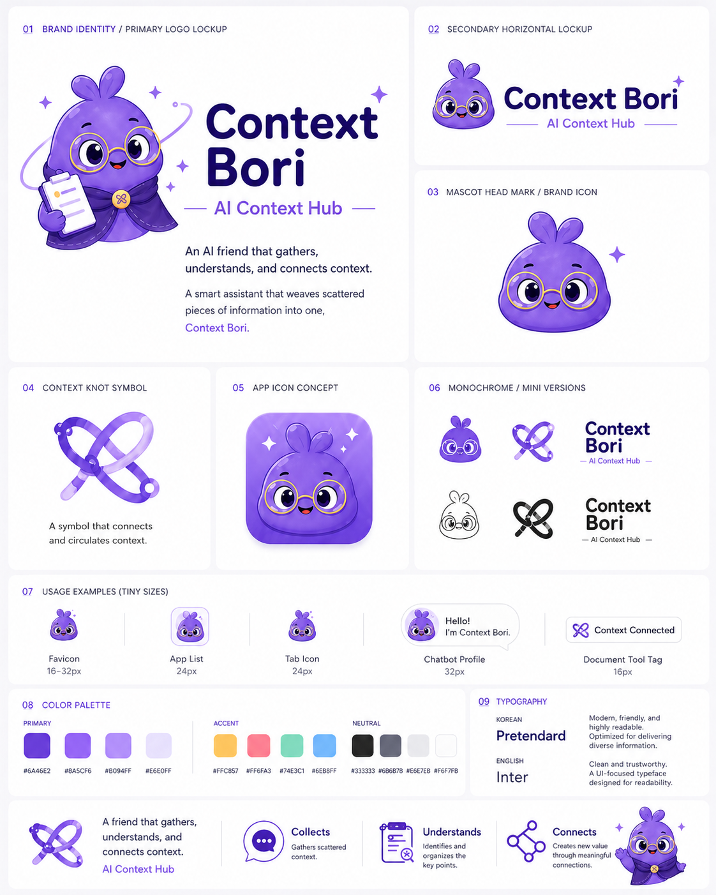
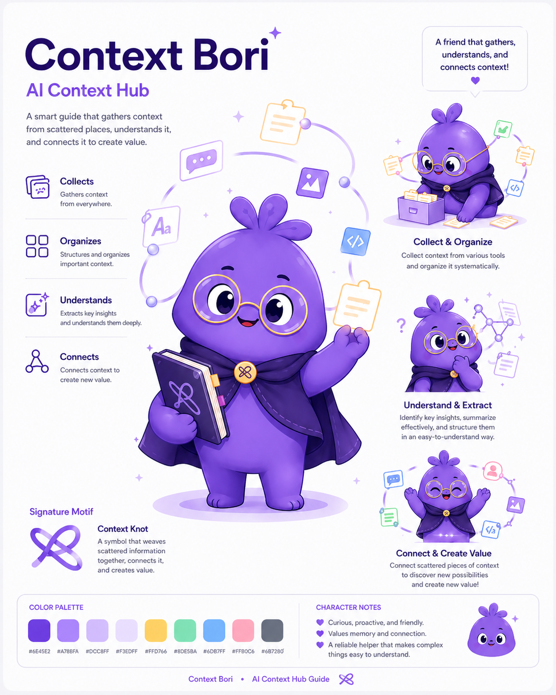

# Context Boradori

[한국어](./README.md) | [English](./README.en.md)

**Context Boradori** is a personal AI context hub for people who work across ChatGPT, Claude, Codex, Gemini, and other AI tools.

Paste scattered AI work context, and the app turns it into a session summary, decisions, open questions, next actions, handoff markdown, and agent instruction exports that the next AI can continue from.

## Demo

- Live demo: [https://context-boradori.vercel.app](https://context-boradori.vercel.app)
- English view: [https://context-boradori.vercel.app/?lang=en](https://context-boradori.vercel.app/?lang=en)

The public demo is for trying the features. For real work context, run it on your own machine as described in [Local Secure Usage](#local-secure-usage).

## Problem

When people use several AI tools on the same project, the working context becomes fragmented. Decisions, open questions, and next actions get trapped in separate chats, and the user has to explain the same background again and again.

Context Boradori collects those fragments into one shared project memory so the next AI tool can continue in the same direction.

## Solution

Users paste work context from ChatGPT, Claude, Codex, Gemini, or another AI tool. The MVP runs local mock compression in the browser, organizes the context, and merges multiple tool sessions into one common handoff.

The key idea is not just summarization. It is the **north star**: confirmed decisions, open questions, and next actions are tied to one shared direction so future work stays aligned across tools.

## MVP Features

- Project name input
- Source AI tool selector
- Target AI tool selector
- Raw context paste area
- Local mock compression with no external AI API
- Multi-source common context tray
- Common handoff merge from multiple AI tool sessions
- Visual common-context map with a north-star direction
- Mermaid session map that groups collected sessions by tool (click a node to open the session, copy the Mermaid code)
- Editable project north star
- Korean/English UI toggle
- Browser `localStorage` persistence for demo continuity
- Session summary, decisions, proposed ideas, open questions, next actions
- `handoff.md`, `AGENTS.md`, `CLAUDE.md`, `GEMINI.md` exports
- Copy buttons and markdown downloads
- Public repo safety warning
- Basic redaction for common API key/token patterns

## User Flow

1. Enter a project name and choose the source AI tool.
2. Paste raw context from that tool.
3. Add the context piece to the common tray.
4. Review or edit the project north star.
5. Choose the target AI tool and merge the common context.
6. Review the common-context map and handoff exports. With many sessions, click a node in the session map to jump straight to that session.
7. Copy or download the result for the next AI tool.

## Brand

Context Boradori is a cute but smart AI context librarian. The brand verbs are **collect, understand, compress, connect**.





## Security Note

Do not paste API keys, passwords, tokens, private URLs, or private financial information into this app.

The current MVP does not call external AI APIs and does not send raw context to a server. The common tray is stored only in the current browser for demo continuity. Future AI/API features should add stronger redaction and explicit user consent before sending any content outside the browser.

## Local Secure Usage

Put real work context only into a copy of Context Boradori running on your own machine. The app never sends context to a server, but running it locally means only code you have checked runs, and no other device can reach it.

### Install and run

```bash
git clone https://github.com/misolove/context-boradori.git
cd context-boradori
npm ci
npm run local
```

Open [http://127.0.0.1:3107](http://127.0.0.1:3107) in your browser.

- `npm run local` makes a production build and serves it only on `127.0.0.1:3107`. Other devices on the same Wi-Fi cannot reach it.
- `npm ci` installs exactly the versions pinned in `package-lock.json`.
- To stay on a version you reviewed, run `git checkout <commit or tag>` first.
- Optionally run `npx next telemetry disable` once to turn off Next.js anonymous telemetry.

### Where data is stored

- The tray and north star live in browser localStorage for `http://127.0.0.1:3107` only. `localhost:3107` counts as a different address with separate storage, so always open the same one.
- Clearing browser data also clears the tray. Download results you want to keep as markdown and store them in a private repository or local folder.
- Never commit real context or exports to this public repository. `.ai/private/`, `.ai/raw/`, and `*.private.md` are already in `.gitignore`.

### Protections in place

- **127.0.0.1 binding:** the local server only listens inside this machine.
- **Content Security Policy:** the page cannot send fetch, image, or form requests anywhere but its own address. Even if dependency code were compromised, the browser blocks most ways of sending context out.
- **Extra headers:** `Referrer-Policy: no-referrer`, `X-Content-Type-Options: nosniff`, no embedding in other sites' iframes, and camera/microphone/location access disabled.

### Limits

- CSP cannot stop data leaving through a page navigation, and inline scripts stay allowed because Next.js bootstraps with them.
- Browser extensions can read page content. A dedicated browser profile without extensions is the safest place to use it.
- `npm run dev` is for development: it is reachable from your network and uses a looser CSP. Use `npm run local` for real context.

### Updating

Review the changes before pulling them in.

```bash
git pull
npm ci
npm audit --omit=dev
npm run local
```

## Sharing Sessions Across Devices (Private Repository)

Tray sessions from one device can be opened on another through a private repository. Each session is saved as one markdown file (`projects/<shared-folder>/sessions/*.md`) and exchanged with git. Neither the config nor any session goes into this public repository.

### Setup (once per device)

1. Clone your private repository.

   ```bash
   git clone https://github.com/<you>/context-boradori-memory.git
   ```

2. Create `.boradori/config.json` in the app folder. `.boradori/` is ignored by git.

   ```json
   {
     "memoryWorkspacePath": "/absolute/path/to/context-boradori-memory",
     "deviceName": "macbook-air"
   }
   ```

   Give each device a different `deviceName` using letters, digits, `.`, `_`, or `-`.

3. Run `npm run local`. A **Share across devices** box appears in the tray.

### Order of steps

- **Sending device:** click **Sync with shared folder** in the app, then run `npm run sync` in a terminal.
- **Receiving device:** run `npm run sync`, then click **Sync with shared folder** in the app.

`npm run sync` commits only changes in the session folders (`projects/*/sessions/`), pulls other devices' commits, and pushes. Other files in the private repository are left alone.

### How it behaves

- The shared folder comes from the **Shared folder** field in the share box and defaults to `context-boradori` (→ `projects/context-boradori/sessions`). Changing the project name or UI language does not change it; edit the field to use another folder. The value is kept in this browser.
- Each session carries the name of the device that first shared it, shown in the tray and the session map.
- Existing files are never overwritten, so a session edited by hand in the private repository keeps the edit.
- Files with broken markers or a newer `format` version are skipped, and the sync message says "Could not read N files". The terminal running `npm run local` lists their names.
- Deleting a session from the tray does not delete it from the shared folder. To remove it everywhere, delete the file and run `npm run sync`.
- Raw context is never stored, only the organized result, and API key, token, and password patterns (GitHub/AWS/Slack tokens, JWTs, `password=`, and more) are redacted once more before saving.
- The sharing API is only on when the local server has `.boradori/config.json`, and it only accepts requests from the app at the same address.
- The tray keeps the latest 40 sessions.

## Local Development

```bash
npm install
npm run dev
```

Open:

[http://localhost:3000](http://localhost:3000)

Useful checks:

```bash
npm run lint
npm test
npm run build
npm audit --omit=dev
```

## Project Memory

The shared project memory lives in `.ai/`:

- `.ai/project_brief.md`
- `.ai/current_state.md`
- `.ai/next_actions.md`
- `.ai/decisions/`
- `.ai/handoffs/`

## Future Expansion

After the hackathon MVP, the goal is not simply to add more features. The goal is to improve the **handoff quality** so the next AI tool can trust and continue the work immediately.

### 1. Handoff Quality

- Tool-specific handoff formats for ChatGPT, Claude, Codex, and Gemini
- Stricter separation of confirmed decisions, proposed ideas, open questions, and next actions
- Conflict detection when different AI tools suggest competing directions
- Turn the editable north star into a reusable project doctrine

### 2. Memory And Common-Context Map

- IndexedDB-based local project storage
- Compare previous handoffs with the current one
- Show decisions, questions, conflicts, and next actions as visual nodes in the common-context map
- Private-first workflow where the user controls whether raw context is stored

### 3. Integrations

- Optional real LLM compression
- Streaming result UI with the Vercel AI SDK
- GitHub issue, PR, and export workflows
- CLI/MCP handoff for Codex, Claude Code, and Gemini CLI
- Longer-term Chrome extension or clipboard helper for easier context collection

### 4. Trust And Safety

- Stronger secret redaction
- Better detection for API keys, tokens, DB URLs, and private URLs
- Redaction preview and explicit user consent before any external AI API call
- Keep the public-repo safety principle: do not store raw context in a public repository

## License

MIT License. See [`LICENSE`](./LICENSE).
