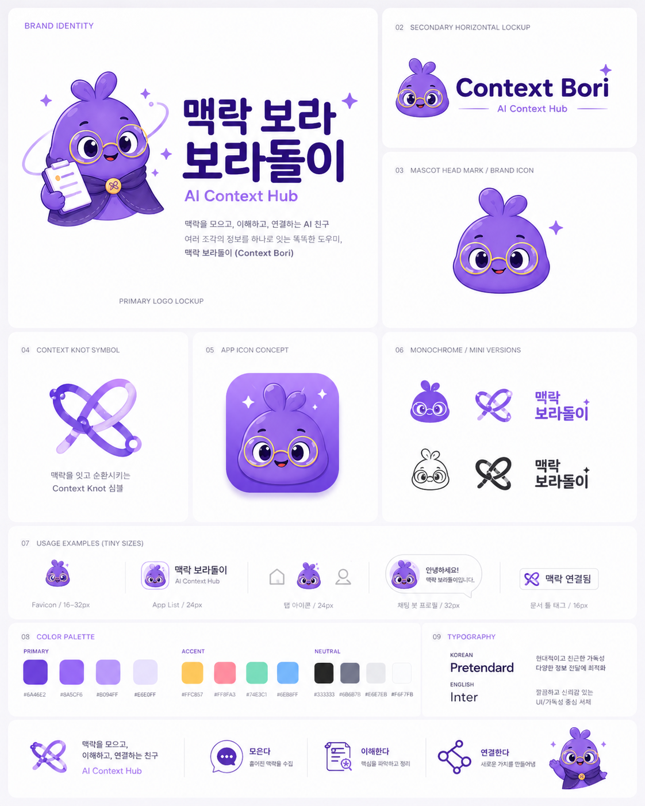
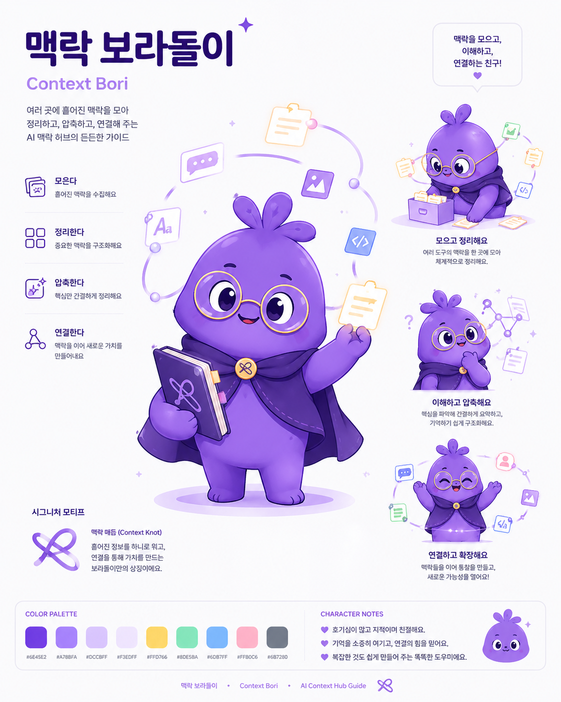

# 맥락 보라돌이

[한국어](./README.md) | [English](./README.en.md)

**맥락 보라돌이**는 ChatGPT, Claude, Codex, Gemini처럼 여러 AI 도구를 오가며 일하는 사람을 위한 개인 AI 컨텍스트 허브입니다.

흩어진 AI 작업 맥락을 붙여넣으면, 다음 AI가 바로 이어받을 수 있도록 세션 요약, 결정사항, 열린 질문, 다음 액션, handoff markdown, agent instruction 파일로 정리합니다.

## 데모

- Live demo: [https://context-boradori.vercel.app](https://context-boradori.vercel.app)
- English view: [https://context-boradori.vercel.app/?lang=en](https://context-boradori.vercel.app/?lang=en)

공개 데모는 기능을 둘러보는 용도입니다. 실제 작업 맥락은 [로컬 보안 사용 가이드](#로컬-보안-사용-가이드)대로 내 컴퓨터에서 실행해 쓰세요.

## 문제

여러 AI 도구를 함께 쓰면 각 도구마다 대화 맥락과 작업 이력이 흩어집니다. 그래서 다음 AI에게 같은 설명을 반복해야 하고, 결정사항과 다음 액션이 쉽게 유실됩니다.

맥락 보라돌이는 이 흩어진 작업 맥락을 하나의 공통 프로젝트 기억으로 모으고, 다음 AI 도구가 같은 방향으로 이어받도록 돕습니다.

## 해결 방식

사용자는 ChatGPT, Claude, Codex, Gemini 등의 작업 맥락을 붙여넣습니다. 앱은 브라우저 안에서 로컬 mock compression을 실행해 맥락을 정리하고, 여러 도구의 결과를 공통맥락으로 병합합니다.

핵심은 단순 요약이 아니라 **북극성**입니다. 확정된 결정, 열린 질문, 다음 액션을 하나의 공통 방향으로 묶어 어떤 AI 도구에서 이어서 진행하더라도 같은 목표를 향하도록 합니다.

## MVP 기능

- 프로젝트 이름 입력
- 출처 AI 도구 선택
- 대상 AI 도구 선택
- Raw context 붙여넣기
- 외부 AI API 없는 로컬 mock compression
- 여러 AI 도구 맥락을 담는 공통맥락 수집함
- 여러 맥락 조각을 하나의 공통 handoff로 병합
- 북극성 기반 공통맥락 지도
- 편집 가능한 프로젝트 북극성
- 한국어/영어 UI 토글
- 브라우저 `localStorage` 기반 데모 지속성
- 세션 요약, 결정사항, 제안, 열린 질문, 다음 액션 추출
- `handoff.md`, `AGENTS.md`, `CLAUDE.md`, `GEMINI.md` export
- 복사 버튼과 markdown 다운로드
- 공개 repo 안전 경고
- 기본 API key/token 패턴 redaction

## 사용 흐름

1. 프로젝트 이름과 출처 AI 도구를 선택합니다.
2. 해당 도구에서 진행한 raw context를 붙여넣습니다.
3. `공통맥락에 추가`로 여러 AI 도구의 맥락을 수집합니다.
4. 프로젝트 북극성을 확인하거나 수정합니다.
5. 대상 AI 도구를 선택하고 `공통맥락 병합`을 누릅니다.
6. 공통맥락 지도와 handoff export를 확인합니다.
7. 다음 AI 도구에 맞게 복사하거나 markdown 파일로 다운로드합니다.

## 브랜드

맥락 보라돌이는 귀엽지만 똑똑한 AI context librarian입니다. 브랜드 키워드는 **모은다, 이해한다, 압축한다, 연결한다**입니다.





## 보안 메모

API 키, 비밀번호, 토큰, private URL, 개인 금융정보는 붙여넣지 마세요.

현재 MVP는 외부 AI API를 호출하지 않고, raw context를 서버로 보내지 않습니다. 공통맥락 수집함은 데모 연속성을 위해 현재 브라우저에만 저장됩니다. 향후 실제 AI API를 붙일 경우 더 강한 redaction과 명시적 사용자 동의가 필요합니다.

## 로컬 보안 사용 가이드

실제 작업 맥락은 내 컴퓨터에서 실행한 맥락 보라돌이에만 넣으세요. 앱은 원래 맥락을 서버로 보내지 않지만, 로컬에서 쓰면 내가 확인한 코드만 실행되고 다른 기기에서는 접속할 수 없습니다.

### 설치와 실행

```bash
git clone https://github.com/misolove/context-boradori.git
cd context-boradori
npm ci
npm run local
```

브라우저에서 [http://127.0.0.1:3107](http://127.0.0.1:3107)을 엽니다.

- `npm run local`은 production 빌드를 만든 뒤 `127.0.0.1:3107`에서만 띄웁니다. 같은 Wi-Fi의 다른 기기에서는 접속할 수 없습니다.
- `npm ci`는 `package-lock.json`에 고정된 버전 그대로 설치합니다.
- 검토한 버전에 고정하려면 `git checkout <커밋 또는 태그>` 후 실행합니다.
- Next.js 익명 텔레메트리를 끄려면 `npx next telemetry disable`을 한 번 실행합니다(선택).

### 데이터가 저장되는 곳

- 수집함과 북극성은 브라우저 localStorage의 `http://127.0.0.1:3107` 주소에만 저장됩니다. `localhost:3107`은 다른 주소로 취급되어 저장소가 따로 생기니 항상 같은 주소로 여세요.
- 브라우저 데이터를 지우면 수집함도 사라집니다. 남겨야 할 결과는 markdown으로 내려받아 비공개 저장소나 로컬 폴더에 보관하세요.
- 실제 맥락이나 export 파일을 이 공개 저장소에 커밋하지 마세요. `.ai/private/`, `.ai/raw/`, `*.private.md`는 `.gitignore`에 들어 있습니다.

### 적용된 보안 장치

- **127.0.0.1 바인딩:** 로컬 서버가 이 컴퓨터 안에서만 열립니다.
- **Content Security Policy:** 페이지가 자기 주소가 아닌 곳으로 fetch, 이미지, 폼 요청을 보내지 못합니다. 의존성 코드가 오염되더라도 맥락을 외부로 보내는 대부분의 경로를 브라우저가 막습니다.
- **추가 헤더:** `Referrer-Policy: no-referrer`, `X-Content-Type-Options: nosniff`, 다른 사이트의 iframe 삽입 차단, 카메라·마이크·위치 권한 차단.

### 한계

- CSP는 페이지 이동으로 데이터를 넘기는 경우까지는 막지 못합니다. Next.js 부트스트랩 스크립트 때문에 인라인 스크립트도 허용되어 있습니다.
- 브라우저 확장 프로그램은 페이지 내용을 읽을 수 있습니다. 확장 프로그램이 없는 전용 브라우저 프로필에서 쓰는 것이 가장 안전합니다.
- `npm run dev`는 개발용이라 같은 네트워크에 열리고 CSP도 느슨합니다. 실제 맥락에는 `npm run local`을 쓰세요.

### 업데이트

변경 내용을 확인한 뒤 받습니다.

```bash
git pull
npm ci
npm audit --omit=dev
npm run local
```

## 로컬 개발

```bash
npm install
npm run dev
```

Open:

[http://localhost:3000](http://localhost:3000)

Useful checks:

```bash
npm run lint
npm run build
npm audit --omit=dev
```

## 프로젝트 메모리

공식 프로젝트 메모리는 `.ai/` 디렉터리에 둡니다.

- `.ai/project_brief.md`
- `.ai/current_state.md`
- `.ai/next_actions.md`
- `.ai/decisions/`
- `.ai/handoffs/`

## 향후 확장

해커톤 MVP의 다음 목표는 기능을 무작정 늘리는 것이 아니라, **다음 AI가 믿고 이어받을 수 있는 handoff 품질**을 높이는 것입니다.

### 1. Handoff 품질

- 대상 도구별 handoff 최적화: ChatGPT, Claude, Codex, Gemini가 바로 실행하기 좋은 형식으로 분리
- 확정된 결정, 미확정 아이디어, 열린 질문, 다음 액션을 더 엄격하게 분류
- 여러 AI 도구가 서로 다른 제안을 했을 때 충돌 의견을 감지하고 비교
- 북극성을 재사용 가능한 프로젝트 doctrine으로 발전

### 2. 기억과 공통맥락지도

- IndexedDB 기반 프로젝트별 로컬 저장
- 이전 handoff와 현재 handoff 비교
- 공통맥락지도에서 결정, 질문, 충돌, 다음 액션을 시각 노드로 표시
- raw context 저장 여부를 사용자가 선택하는 private-first workflow

### 3. 연결성

- 선택형 실제 LLM compression 추가
- Vercel AI SDK 기반 streaming result UI
- GitHub issue/PR/export workflow
- Codex, Claude Code, Gemini CLI가 이어받기 쉬운 CLI/MCP handoff
- 장기적으로 Chrome extension 또는 clipboard helper를 통한 맥락 수집 자동화

### 4. 신뢰와 보안

- 더 강한 secret redaction
- API key, token, DB URL, private URL 탐지 강화
- 외부 AI API 호출 전 redaction preview와 명시적 사용자 동의
- public repo에 raw context를 저장하지 않는 안전한 export 원칙 유지

## 라이선스

MIT License. See [`LICENSE`](./LICENSE).
